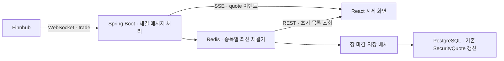

# MIPS

### 인증 기반 미국 주식 시세 조회 및 자산 관리 플랫폼

MIPS는 금융권 시스템 개발 경험을 바탕으로 인증, 시세 조회, 결제·예수금 관리와 주식 주문 흐름을 구현하는 개인 풀스택 프로젝트입니다.

React와 Spring Boot를 분리하고, Finnhub WebSocket으로 수신한 체결 데이터를 Redis에 저장한 뒤 SSE로 브라우저에 전달합니다. JWT·OAuth2 인증과 테스트 결제 연동을 구현했으며, 매수·매도 주문과 체결 시 동시성 제어를 다음 단계로 개발할 예정입니다.

> 구현 현황은 2026-10-29 확인한 `main` 코드 기준입니다. 구현된 범위와 추가 개발이 필요한 범위를 구분해 기록합니다.

## 주요 기능

### 구현 완료

- **인증**: Google·Kakao OAuth2 로그인, Spring Security 기반 JWT 발급·검증 및 Access Token 재발급
- **토큰 관리**: Access Token은 Web Worker 메모리, Refresh Token은 HttpOnly 쿠키에 분리 보관
- **종목 데이터 수집**: Nasdaq-100 구성종목 API 기반 종목 마스터 동기화 및 Spring Batch·Scheduler 연동
- **실시간 시세**: Finnhub WebSocket 체결 데이터 수신, 종목별 최신 체결가·체결 시각 Redis 저장, REST 초기 조회 및 SSE 화면 갱신
- **시세 화면**: 티커·종목명 검색, 연결 상태 및 최근 체결 시각 표시, 가격 변동 강조
- **연결 복구**: Finnhub 연결 종료·전송 오류 시 지수 백오프를 적용한 재연결 및 재구독
- **장 마감 저장**: Redis의 최신 시세로 기존 `SecurityQuote`의 현재가·시세 시각을 갱신하는 배치 구성
- **테스트 결제**: PortOne 카카오페이 연동, 결제 단건 조회 결과에 따른 충전·결제 상태 및 예수금 반영 로직
- **기반 구조**: 사용자·계좌·충전·결제·종목·주문 엔티티 설계, React 기본 화면·라우팅 구성

### 일부 구현 / 추가 검증 필요

- **환율**: 한국수출입은행 환율 조회 클라이언트와 환산 서비스 구현. 화면 연동 및 통화 방향·정밀도·반올림 정책 검증 필요
- **ETF**: 공통 종목 마스터와 ETF 상세 엔티티 설계. ETF 전용 데이터 수집·조회 기능 확장 필요
- **결제 안정성**: 테스트 결제 연동 범위를 넘어 중복 통지·멱등성·동시성 및 실패 시나리오 검증 필요
- **로컬 실행 환경**: 기존 README에 Docker 기반 애플리케이션·PostgreSQL 실행 테스트 이력 기록. 운영 배포 검증은 별도 진행

### 구현 예정

- 일반 회원가입 및 로그인 API
- 주식 매수·매도 주문 처리 및 주문 체결 시 동시성 제어
- 거래 내역 및 자산 현황 조회 기능 완성

## 실시간 시세 흐름



1. 애플리케이션 시작 시 DB의 활성 NASDAQ 종목을 조회하고 **최대 5종목**을 Finnhub에 구독 요청합니다. 이는 현재 코드의 제한값입니다.
2. `trade` 메시지 한 건에 같은 종목의 체결 데이터가 여러 개 있으면, 체결 시각이 가장 최신인 항목을 선택합니다.
3. 티커·가격·체결 시각이 있는 데이터를 Redis의 `quote:latest:{ticker}`에 저장합니다. 캐시 TTL은 1일입니다.
4. 화면 진입 시 `GET /api/stock/us/realtime`으로 캐시 기반 초기 목록을 조회하고, 이후 `GET /api/stock/us/realtime/stream`의 SSE `quote` 이벤트로 가격과 체결 시각을 갱신합니다.
5. 미국 뉴욕 시간 평일 16:05에 장 마감 저장 배치를 실행해 캐시의 최신값으로 기존 `SecurityQuote`를 갱신합니다.

### 현재 제공 범위

- 화면의 가격은 **수신한 최신 체결가**입니다. 호가·전체 체결 내역·분봉 OHLC를 제공하는 구조는 아닙니다.
- Nasdaq-100 구성종목 수집과 최대 5종목 실시간 구독은 별도 작업입니다. 전체 NASDAQ 상장종목의 실시간 시세를 제공하지 않습니다.
- 기존 장중 Finnhub REST 주기 조회 스케줄은 WebSocket 전환 후 비활성화되어 있습니다. 종목 동기화와 장 마감 저장 스케줄은 별도로 구성되어 있습니다.
- 장 마감 배치는 기존 시세 행만 갱신합니다. 신규 행 생성과 가격 이력 누적은 이 저장 경로에 포함되지 않습니다.
- 장 마감 실행 시각은 평일 기준이며 거래소 휴장일 판별은 추가 보완이 필요합니다. 저장값은 캐시의 마지막 체결가이므로 공식 종가와 구분합니다.
- SSE 구독자는 현재 애플리케이션 프로세스 안에서 관리합니다. 다중 서버 간 이벤트 전달과 연결 중 누락 데이터 재전송은 추가 설계가 필요합니다.

## 기술 스택

| 구분 | 기술 |
| --- | --- |
| Frontend | React, TypeScript, Vite, ESLint, EventSource(SSE) |
| Backend | Java 17, Spring Boot 3.5.13, Spring Security, Spring Data JPA, Hibernate |
| 실시간·배치 | Spring WebSocket Client, SseEmitter, Spring Batch, Scheduler |
| 데이터 저장 | PostgreSQL, Redis |
| 빌드·로컬 실행 | Gradle, Docker |
| 외부 연동 | Finnhub, Nasdaq 구성종목 API, PortOne, Google·Kakao OAuth2, 한국수출입은행 환율 API |

프론트엔드와 백엔드 디렉터리를 분리하고, 백엔드는 단일 Gradle 모듈 안에서 도메인별 패키지로 구성합니다.

## 기술적 구현 포인트

### 외부 데이터 수신과 브라우저 전달 분리

외부 시세 수신에는 WebSocket을, 서버에서 브라우저로 전달하는 시세 갱신에는 SSE를 사용합니다. Redis에 최신값을 저장해 초기 목록 조회와 이후 이벤트 갱신을 연결하고, 매 체결마다 DB에 쓰는 대신 장 마감 배치에서 저장하도록 역할을 나눴습니다.

### 연결 생명주기와 오류 복구

Finnhub 연결 관리는 메시지 처리와 분리되어 있습니다. 재연결 대기 시간을 1초부터 최대 30초까지 늘리고, 연결 성공 시 구독을 다시 요청합니다. 중복 연결·재연결 예약을 방지하고 종료 시 세션과 예약 작업을 정리합니다. SSE는 완료·타임아웃·오류 발생 시 구독자를 제거합니다.

### 외부 REST 오류 분류와 Batch 재시도

기존 Finnhub REST 조회 경로는 HTTP 429와 일시적 5xx·네트워크 오류를 커스텀 예외로 구분하고, Spring Batch Retry와 지수 백오프에 연결했습니다. 해당 Job 정의는 유지하고 있으며 장중 정기 실행은 현재 비활성화되어 있습니다. Chunk 크기와 외부 API 호출 간격은 별도로 관리합니다.

### 인증 정보 보관 위치 분리

OAuth2 로그인 후 JWT를 발급하고 Spring Security 필터에서 검증합니다. Access Token은 Web Worker 메모리, Refresh Token은 HttpOnly 쿠키에 보관해 토큰별 접근 범위와 수명을 분리합니다.

### 종목 마스터·최신 시세·가격 이력 모델 분리

`SecurityMaster`를 공통 종목 마스터로 두고 주식·ETF 상세와 지수 구성관계·산업 분류를 분리했습니다. `SecurityQuote`는 최신 시세, `SecurityPriceHistory`는 시점별 가격 이력을 표현합니다. 엔티티 설계 범위와 실제 저장 경로의 구현 범위를 구분해 확장하고 있습니다.

## 도메인 구성

| 도메인 | 책임 |
| --- | --- |
| User | 사용자 및 인증 연계 |
| Account | 예수금 계좌 및 잔액 |
| Charge | 충전 요청 및 이력 |
| Payment | 외부 결제 요청·결과 및 원문 기록 |
| Stock | 종목 마스터·상세·분류·시세 |
| Order | 매수·매도 주문 모델 — 처리 기능은 구현 예정 |
| Comm | 공통 응답·코드·유틸리티 및 환율 연동 |

## 프로젝트 구조

```text
frontend/
└── mips-frontend/          # React · TypeScript
backend/
└── MIPS/                  # Spring Boot · 단일 Gradle 모듈
    └── src/
        ├── main/java/com/mips/
        │   ├── domain/    # 업무 도메인
        │   └── global/    # 인증·설정·배치·WebSocket 공통 구성
        └── test/          # 테스트
```
